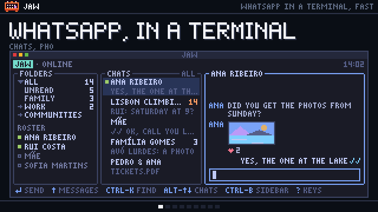
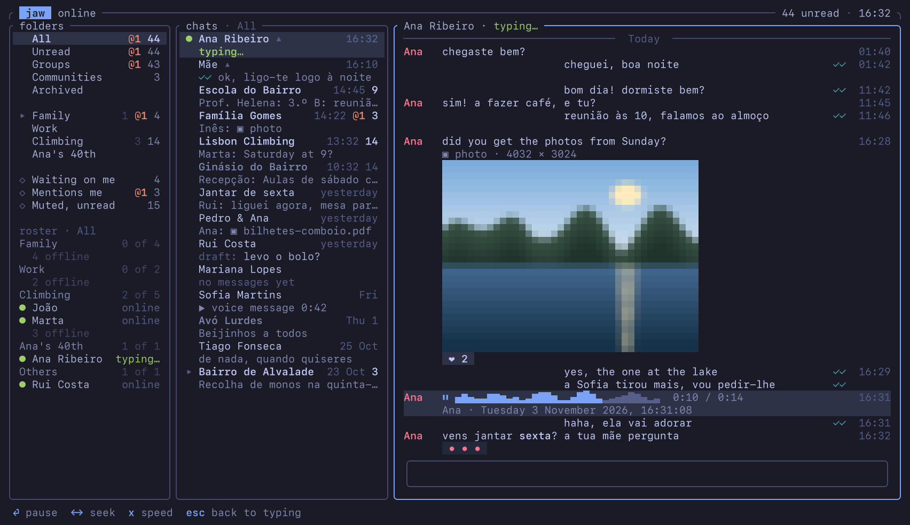
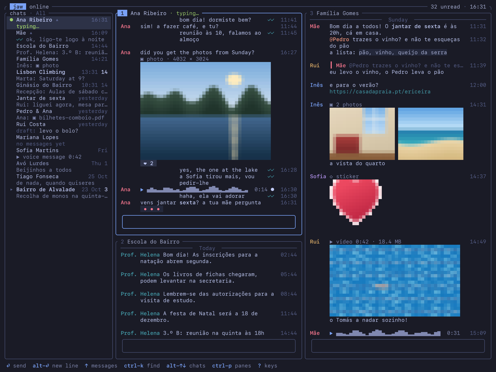
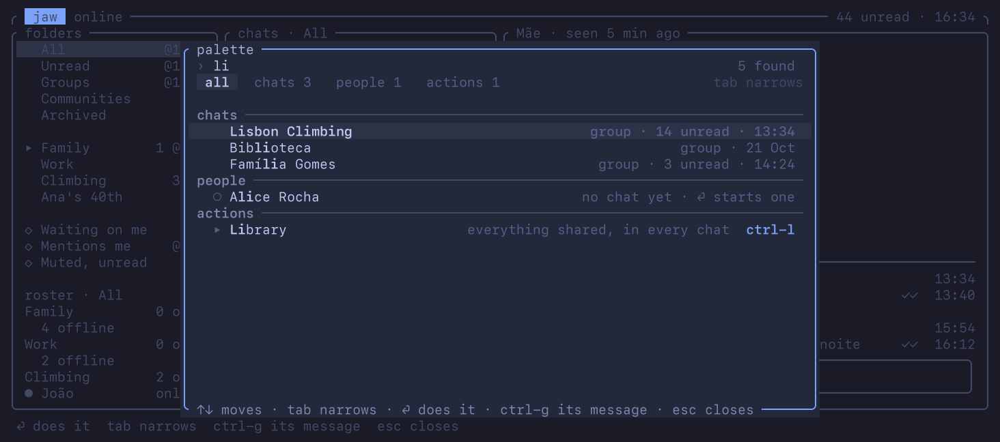
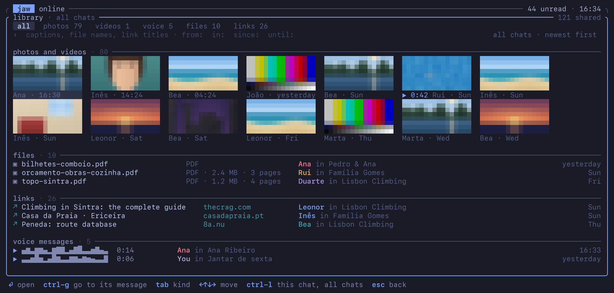
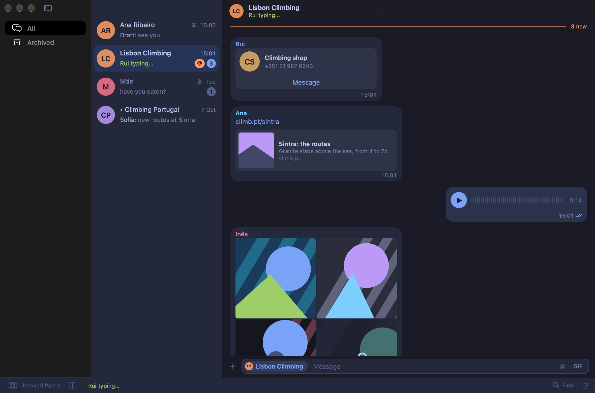
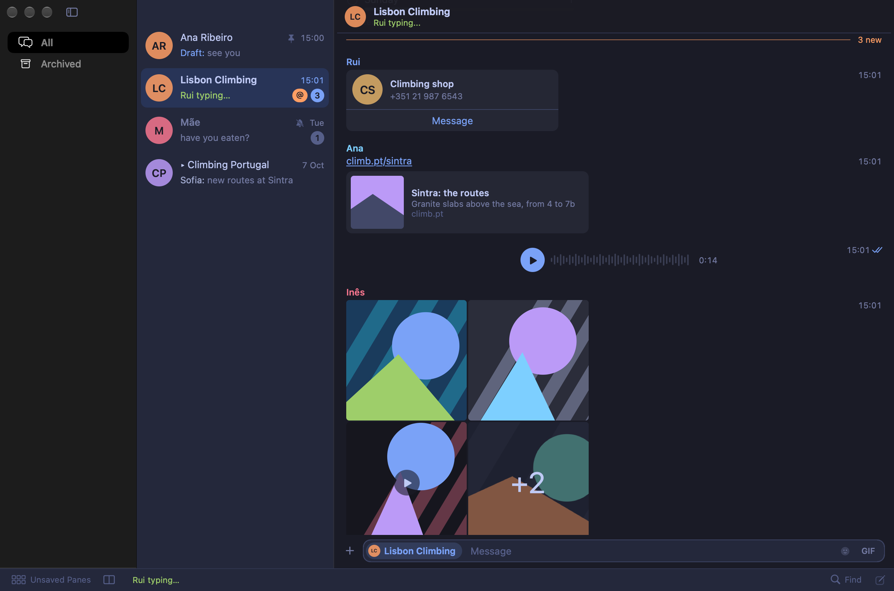
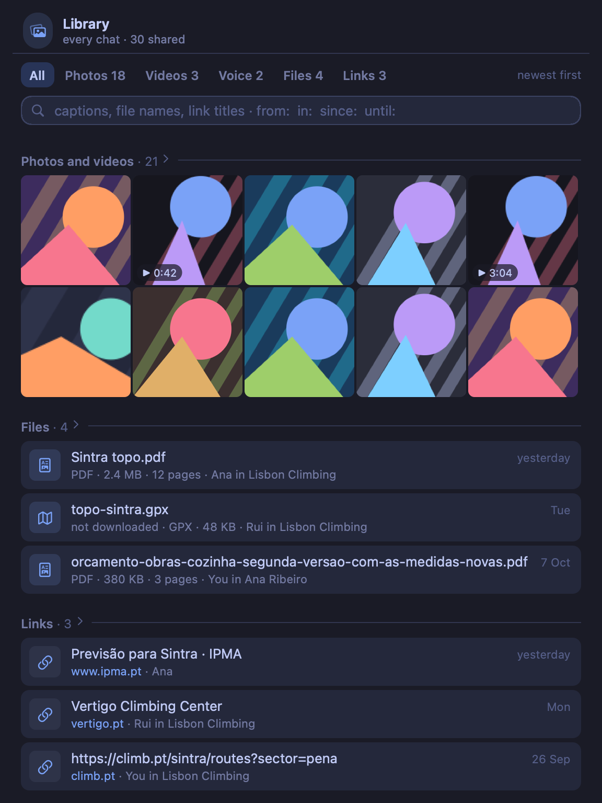

# jaw

jaw is a fast WhatsApp client for the Mac. Its daemon, jawd, is linked to WhatsApp as one of your devices, keeps your chats and messages on your Mac and does all the work; a terminal app, `jaw`, and a Mac app, Jaw, only draw what jawd serves them, over one socket protocol. So opening either never waits on WhatsApp, and your chats, photos, voice messages and polls are there whether it can be reached or not. In the style of [ooze](https://github.com/pdcgomes/ooze), with [badcoffee.dev](https://badcoffee.dev)'s Mimic.

[](marketing/jaw-in-a-minute/)

[The design](docs/plans/2026-10-16-jaw-design.md) says how it works and why, and [the protocol](protocol/README.md) how an interface talks to jawd.

## What it does

Every picture here is of a made-up account. The terminal's are frames `jaw snapshot --demo` draws, with their photos in half-blocks, as a terminal without graphics shows them; kitty, iTerm2 and sixel terminals draw them whole. The Mac's are scenes from its component harness.



The terminal: folders and the roster beside the chat list, and a conversation with a photo, a voice message playing and someone typing.



Split panes, one chat in each, here with an album, a sticker, a video and a voice message in the family's; they're behind `JAW_EXPERIMENTS=panes` for now.



Ctrl-K finds anything: chats, people to start one with, folders, actions with their keys, and messages, links and files.



Ctrl-L opens the library of everything shared, in every chat or in one, searched by caption, file name and link title, and by `from:`, `in:`, `since:` and `until:`.



Jaw, the Mac app: the sidebar, the chat list and a chat opened at its first unread, its messages in bubbles.



The same chat in lines, as the terminal draws them: names heading their messages, and times on the right.



The library on the Mac, a pane of its own beside the chats: ⌘L for every chat, ⌥⌘L for the one you're in.

## Install

jaw is three programs: `jaw`, the terminal app; `jawd`, the daemon; and `jaw-engine`, which speaks WhatsApp for jawd. Either way below builds them from source, with Go and Rust.

With Homebrew:

```sh
brew install pdcgomes/jaw/jaw
```

Homebrew builds them with its own Go and Rust, puts `jaw` and `jawd` in its `bin/` and `jaw-engine` in the formula's `libexec/jaw/`, and installs ffmpeg with them. ffmpeg is recommended rather than needed: text, and everything you receive, work without it, and sending videos, GIFs and audio files says it's missing.

From a checkout:

```sh
make install                  # jaw and jawd in /usr/local/bin, jaw-engine in /usr/local/libexec/jaw
make install PREFIX=~/.local  # or under your home folder, without sudo
make uninstall                # with the same PREFIX, takes them out again
```

`make install` builds them first. Into a folder only root can write, run `make release` as yourself, then `sudo make install`, which builds nothing.

The Mac app isn't in the tap yet. `make mac` builds it, with Xcode and [mise](https://mise.jdx.dev) for Tuist, into `mac/build/release/Jaw.app`, with jawd, jaw-engine and jaw inside it, each signed; [mac/README.md](mac/README.md) has the rest. It's younger than the terminal, and doesn't send photos and files, or play and record voice messages, yet.

### How jawd runs

Run `jaw`. When nothing answers on jaw's socket it starts jawd, and keeps drawing while jawd starts; jawd runs the engine installed beside it, and goes on when jaw quits, so messages and notifications keep coming. The Mac app uses the jawd that's running. To start jawd at login instead, `jaw agent install` installs it as a LaunchAgent (`jaw agent status` says how it is, `jaw agent uninstall` takes it out), or the Mac app's Jaw › jawd at Login… starts its own, offering to take over the terminal's, so only one ever runs.

All three programs say one version (`jaw --version`), taken from `git describe`, and when the jawd still running after an upgrade is another build, jaw says so and how to stop it. Your chats stay in jaw's folder, `~/Library/Application Support/jaw`, whichever jaw you run.

## First run

Run `jaw`. jawd isn't linked yet, so jaw shows a QR code beside the Mimic, as the Mac app does: on your phone, open WhatsApp › Settings › Linked devices › Link a device, and point it at the code. `p` in the terminal, or Use a Phone Number Instead in the Mac app, links with a code you type on the phone instead, and `jaw link` does either from the command line. jawd is then one of your linked devices, and the phone lists it as jaw.

Then the phone sends your history, every chat's newest messages first. Chats appear as it comes in, each where its newest message puts it, so older history never moves a chat, and new messages go ahead of it: the history waits while they're stored and acknowledged. `jaw status` says how far it has got. Every message brings its thumbnail, so a photo shows at once. Photos, stickers, GIFs and voice messages that arrive now download by themselves, and those from the history once they're on screen; videos and documents download when you open them. Files gone from WhatsApp's servers, as history from before jaw was linked often is, are asked of the phone again, which needs the phone online. Text becomes searchable as it's indexed, which goes on for a while after a big history is in: a quarter of an hour for a million messages. Scrolling past a chat's oldest message asks the phone for older ones.

After time offline, the terminal's header and the Mac's status line say jawd is catching up, and how far, and notifications wait to come as one summary at the end.

To look around first, `jaw demo` draws the made-up account in the pictures, with no jawd or WhatsApp behind it, and the Mac app's `--demo` runs a jawd of its own on another made-up account.

## How it works

jawd does the work, so every interface gets all of it. It keeps every chat and message in its own database, works out what an interface shows (names, formatting, quotes, reaction and receipt totals, poll tallies, previews sized for display, search, drafts, folders, presence, voice playback and recording, notifications), and serves interfaces on a Unix socket in jaw's folder that only you can reach: one JSON object a line, every request answered as data, and live windows that send what's on screen and then only what changes in it. [The protocol](protocol/README.md) specifies it, so a script, or another app, can be an interface too.

WhatsApp is reached through jaw-engine, a small Go process on [whatsmeow](https://github.com/tulir/whatsmeow), behind an `Engine` trait in jawd. The engine speaks WhatsApp and hands jawd WhatsApp's own protobufs, which jawd understands, so another engine can take its place; the demo engine, with its made-up account, already does, for trying jaw, its tests and its load runs.

Everything stays on your Mac, in jaw's folder, `~/Library/Application Support/jaw` (`$XDG_DATA_HOME/jaw` on Linux), which only you can read: `jaw.db`, jawd's SQLite database, which keeps each message's raw protobuf as the source of truth; `session.db`, whatsmeow's keys for the linked device; and the photos and files jawd downloads. Nothing is acknowledged, to WhatsApp, the phone or an interface, before it's on disk in a way that survives a power cut: WhatsApp hears "received" only once the message is committed and flushed to the drive (`F_FULLFSYNC` on macOS), so after a crash anywhere before that, WhatsApp sends it again.

## What it costs

Measured by `make perf` on 25 October 2026, on a Mac Studio (Apple M1 Ultra, 20 cores, 128 GB, macOS 26.6.2) that other work kept at a load average of 10 to 21, with release builds against `jawd demo`'s made-up account of a million messages in 3,000 chats, and jaw attached as it would be in a terminal. The flood of 2,000 messages a second and the backlog acked in groups come from the demo engine, which hands jawd 256 messages before their acks come back. jaw-engine waits for each ack, since whatsmeow handles one message at a time, so through it a real account's burst drains at the rate of the backlog acked one at a time, about 150 a second.

| | Budget | Measured | Load |
| --- | --- | --- | --- |
| A keypress drawn | 16 ms p99 while 2,000 messages a second arrive | 0.40 ms p99, in the demo engine's flood | 10–11 |
| jaw's first frame | 50 ms after launch, with jawd running | 37 ms median, **58 ms** at worst; from jaw's `main`, 24 and 46 ms | 11–14 |
| Opening a chat | 30 ms | 22 ms p50, 28 ms p99; **53 ms** p99 during the flood | 11–14 |
| jaw's memory | under 40 MB with a screen of images | 35 MB with the library's photos, 14 MB with text | 11–17 |
| An incoming message durable and acknowledged | 10 ms p99 | 8.5 ms p99 over 1,000 one at a time, 8.3 ms through jaw-engine; **13 ms** the worst of 50 lone messages; **14.5 ms** p99 in a catch-up acked one at a time; **23 ms** p99 while the history goes in, 169 ms at worst; **34 ms** p99 in the flood, acked in groups | 10–21 |
| …a backlog draining | 200 a second with each ack waiting for its own flush, 5,000 once acks go in groups | **153** a second, a real account's rate; 8,692 a second with the demo engine's 256 in flight, which jaw-engine doesn't do | 10–11 |
| An incoming message on its way to interfaces, once committed | 5 ms p99 | 2.9 ms p99 | 11–14 |
| jawd's own work in the commit-acked round trip, apart from the flush | under 200 µs p50 | about 60 µs, 110 µs with jaw-engine's hop | 10–11 |
| A 100-message page | 5 ms at any depth | 2.0 ms p99 on the socket, 0.8 ms through the read pool | 11–17 |
| Search | 50 ms over a million messages | 15 ms p99 | 11–14 |
| jawd's memory | under 100 MB steady, 250 MB during a full history sync | 59 MB steady, 81 MB in the flood; **8.4 GB** during the history | 11–21 |
| jaw-engine's memory | under 80 MB steady, 200 MB during a full history sync | 21 to 27 MB, unlinked; not measured during a history | 11 |
| A 12-megapixel photo ready to upload | 300 ms | 96 to 240 ms, as JPEG and HEIC | 13–15 |
| Idle | no drawing, no wake-ups, no polling | jaw: no frames, one wake-up a minute for its clock; jawd: **9 wake-ups** a minute | 11–14 |

Where it falls short, and why:

- **jawd's memory during a full history sync.** The history goes in at 12,000 messages a second, but each blob of 20,000 messages is decoded whole into prost's structs, where a message takes 16 KB whatever it holds because WhatsApp's `Message` keeps its hundred-odd optional parts inline; `convert::history::remainder` then clones the whole blob, and what's freed isn't given back to the system before the next blob. It falls to 89 MB once the history is in, and a fresh jawd on it takes 59 MB. Boxing those parts in wa-proto's code generation, cloning only what `remainder` keeps, or decoding a conversation at a time would each cut it.
- **Indexing for search after the history takes 15 minutes.** An index step that finds the WAL past its soft limit gives way without waking the checkpointer, which copies only once 1,024 frames wait; with nothing else committing, each stall lasts until its 10-second idle timer, while the writer looks again every millisecond. `jawd bench store`, whose live message every 5 ms keeps the checkpointer awake, indexes the same million in 136 s.
- **Durable acks.** A lone message pays one flush, and the drive's `F_FULLFSYNC` alone is 5.0 ms p50 and 9.9 ms p99 here, so the budget sits on the drive's tail: 1,000 round trips came to 8.5 ms p99, but the worst of 50 lone messages, with their conversions and windows going on around them, took 13 ms, and a catch-up acked one at a time came to 14.5 ms p99. While the history goes in, the live messages handed over every 100 ms were acked at 7.8 ms p50, 22.6 ms p99 and 169 ms at worst. The design says history can delay a message by no more than one short transaction, so that's a defect, and its cause isn't established yet: the database expert's audit, which measured 26.9 ms p99 at a load of 21 to 24, didn't find it either. In the flood an ack waits for its group's commit behind the rows before it: 16 ms p50, 34 ms p99.
- **A backlog acked one at a time** drains at 153 a second, and that's a real account's rate, since jaw-engine acks one at a time: each ack waits for its own flush, and converting the message before it takes the writer between flushes.
- **Converting behind a flood.** With the demo engine's 256 acks in flight, acks keep up with 2,000 a second, but turning the inbox into messages on a million-message jaw.db ends 8.5 s after the flood, about 1,750 a second, so in the flood the open chat's messages reached the interface 1.4 s after they were handed over at p50 and 8.4 s at p99. A catch-up acked in groups in 3.5 s is converted in 20 s. Through jaw-engine, which acks one at a time, a burst like this waits on WhatsApp's side and drains at about 150 a second.
- **jaw's first frame and opening a chat.** Between 7 and 37 ms (11 ms median) pass from launch to jaw's `main`: the system starting the process, which on this Mac includes its endpoint security looking at each launch. Within jaw, the first frame and an opened chat each wait for the next frame: jaw-client wakes jaw at most once a frame and the loop draws at most once a frame, so a page jawd answers in 1 ms is drawn about 20 ms after the key. Waking and drawing at once for the answer to what was just asked would take most of that off.
- **Idle.** Six of jawd's nine wake-ups are the checkpointer's 10-second timer, which goes on waking after it has emptied the WAL; it could wait for the next commit instead.
- **Not measured.** jaw-engine's memory during a full history sync needs a linked account, and nothing here talks to WhatsApp. whatsmeow decodes each blob into Go structs, where an absent part is a nil pointer, and the engine encodes it again for the spool, so it should hold a few copies of one blob at a time, tens of MB for blobs like these, plus Go's garbage, which `GOMEMLIMIT` would bound; jawd doesn't set it yet. Nor has the design's small Linux machine been measured; `make perf` is written to run there too, but hasn't yet.

`make perf` takes half an hour, most of it the indexing above, and writes the full table, with how each number was taken, to `target/perf/`. The same account is there to try jaw without WhatsApp: `jawd demo` in one terminal, then `JAW_HOME=$TMPDIR/jaw-demo jaw` in another. Its history takes a minute and a half to arrive the first time, search fills in over the quarter hour after, and `--flood 20` adds some life.

## What's next

After the first release:

- **GIF search,** from Giphy through jawd, jaw's only request to a service besides WhatsApp, made only while a GIF picker is open.
- **Scheduled messages and reminders:** anything jaw sends, at a time you give, once or repeating, sent by jawd at its time and held for you when it's more than an hour late; and reminders on messages, which notify and mark their chat unread, so the phone shows it too.
- **Assistants over MCP:** Claude, Cursor, ChatGPT and other AI assistants reaching jaw through the Model Context Protocol, each through a grant you make in jaw for the folders it sees, read-only unless you allow more, and its sends confirmed in the assistant's app.

## Not affiliated with WhatsApp or Meta

jaw isn't affiliated with WhatsApp or Meta, and WhatsApp's terms don't allow unofficial clients, so use it at your own risk: unofficial clients can get numbers banned.

## License

[MIT](LICENSE). Its themes are [Omarchy's](https://github.com/omacom/omarchy), as Omarchy wrote them, MIT-licensed ([docs/licenses/omarchy.txt](docs/licenses/omarchy.txt)); Ctrl-, or `jaw settings` picks one.
