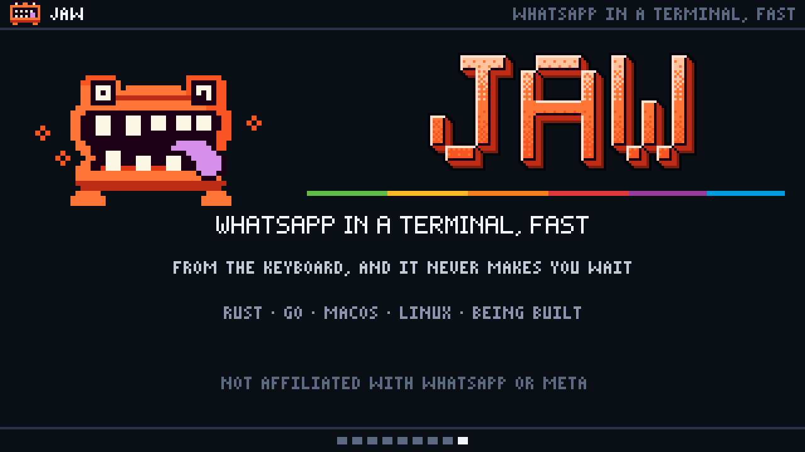

# jaw in a minute

A video explaining jaw: 1280×720, 58.6 seconds, 672 KB. `jaw.gif` is the same at half the size, 593 KB, for jaw's README.

[](jaw.mp4)

1. WhatsApp, in a terminal: jaw's screen, with folders and roster, the chat list and the open chat. A reply goes from pending to read, and a voice message arrives.
2. One daemon does the work: WhatsApp, jaw-engine (Go), jawd (Rust) and jaw. A message goes down to jaw.db and is synced to disk before WhatsApp hears "received", and only then is the row sent to jaw.
3. Any engine behind it: engines are cartridges in jawd's Engine trait. The Go engine and the demo engine exist today; the Rust engine is next.
4. Any interface in front: a terminal (today), a desktop app (later) and anything that speaks JSON lines on jawd's socket. A new message fans out to each, and a draft typed in one shows in another.
5. Nothing ever waits: three lanes into one writer, with live messages first and history in 3 ms slices. The screen reads only its window of a million messages, as fast on page 10,000 as on page 1.
6. Measured, not promised: a keypress drawn in 0.40 ms while 2,000 messages a second arrive, against a 16 ms budget, then five more budgets and what they took.
7. Ctrl-K finds anything: the palette finds chats, messages, links and files, ignores accents ("NAO" finds "NÃO"), and puts actions first, with their keys. It's in jaw today.
8. Several chats at once: split panes, one chat a pane, each keeping its own draft. Exploring: split panes are an idea in the design's "Later", not built.
9. The end card.

The Mimic chomps each scene into the next, with the same chomp jaw draws.

## Where the facts come from

From this repository on 26 October 2026 (main at `9fe850b`); the docstring in `jaw.py` names the source of every claim and number.

- The architecture, the palette and split panes: [the design](../../docs/plans/2026-10-16-jaw-design.md) and the palette itself (`crates/jaw/src/view/palette.rs`).
- The numbers: [What it costs](../../README.md#what-it-costs). They were measured by `make perf` on 25 October 2026 on a Mac Studio (M1 Ultra) with release builds, against `jawd demo`'s made-up account of a million messages in 3,000 chats; the flood of 2,000 messages a second comes from the demo engine. The video shows the budgets jaw meets. "What it costs" also lists where it falls short: jawd's memory during a full history sync, acks while history goes in, and search indexing after it.
- The names and chats are `jaw demo`'s made-up account; the lines are the design's example screen, in English.
- The Mimic is [`creatures/mimic.png`](../../creatures/mimic.png), read from there; jaw's screens are in its Tokyo Night colours (`crates/jaw/src/theme.rs`).

## Drawing it again

It's drawn with the pixelartvisuals kit, `pixelkit` (Python 3.11 or later, Pillow and numpy, and ffmpeg for the MP4), which the pixel-graphics skill links to. From the repository's root:

```bash
export PYTHONPATH=~/.cursor/skills/pixel-graphics/scripts
python3 marketing/jaw-in-a-minute/jaw.py                    # jaw.gif, jaw.mp4 and jaw-poster.png
python3 marketing/jaw-in-a-minute/jaw.py frames 3 10.6 40   # stills at those seconds, in /tmp
```

`jaw.py` holds the timeline and the nine scenes; `parts.py` holds the Mimic, jaw's screen pieces and the glyphs the kit's fonts lack.
